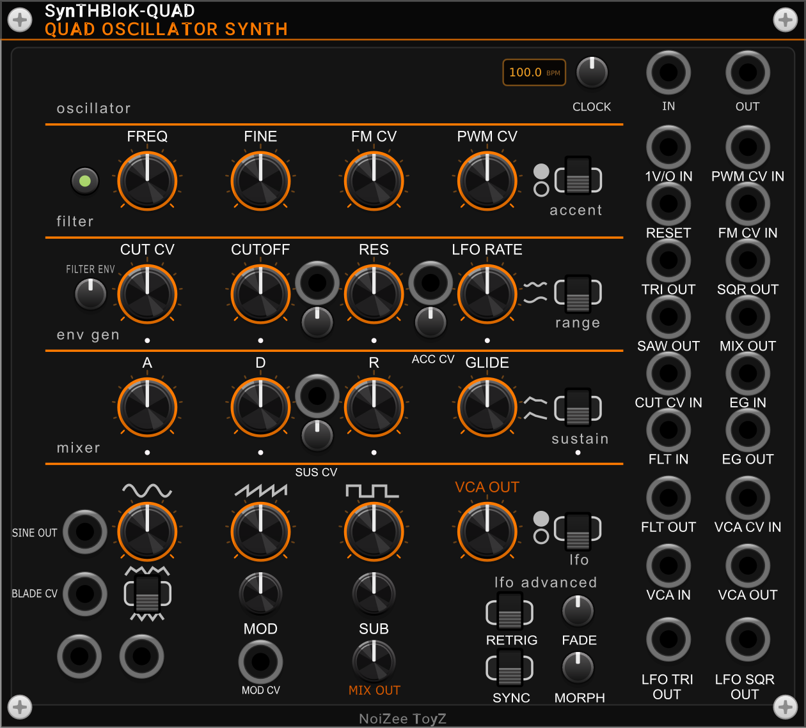

# SynTHBloK

**SynTHBloK** by **NoiZee ToyZ** is a collection of 28 VCV Rack 2 modules for hard techno and live grooveboxes:
synth voices, drum synths, an 8x8 step-sequencer family (MTX), effects, mixers, a mastering strip and a song arranger.
Most MTX modules can be played from a Native Instruments Maschine JAM.



## Install

In VCV Rack 2: **Library > SynTHBloK > Add**. Rack downloads and updates it for you.
Prebuilt packages for every platform are also on the [Releases](https://github.com/nickkollmann-ai/SynTHBloK/releases)
page: put the `.vcvplugin` file in Rack's `plugins` folder and restart Rack.

## Modules

| Module | What it does |
|---|---|
| **SynTHBloK-QUAD Quad Oscillator Synth** | Quad-oscillator synth voice with filter, envelope, glide, accent and LFO |
| **SynTHBloK MTX Quad Oscillator Synth** | The quad-oscillator synth voice played by an 8x8 note grid with per-step accent, cutoff, gate, glide, chance, ratchet, octave and resonance sliders |
| **SynTHBloK DUAL FILTER** | Two stereo multimode filters (LP / BP / notch / HP sweep, 12 / 24 / 48 dB) with drive, run in series, parallel or stereo, linked cutoffs, a four-shape LFO, an ADSR or envelope follower, a stereo phaser and a three-band EQ |
| **SynTHBloK-P Poly** | Polyphonic unison engine for SynTHBloK |
| **SynTHBloK-S Stereo Phaser** | Stereo width, tilt, air, glue, punch and clip, with analyzer |
| **SynTHBloK-DL Character Delay** | Stereo delay with eight characters (clean, tape, analog, modern, ping-pong, dynamic, space, reverse), clock sync, hold and clear |
| **SynTHBloK-R Resonator** | Stereo modal resonator with metal, wood, membrane and tube bodies |
| **SynTHBloK MIX-6 Fire Edition** | Six-channel stereo mixer with per-channel tilt, drive, air and glue, mute/solo, meters and an aux FX bus |
| **SynTHBloK MIX-12 Fire Edition** | Twelve-channel stereo mixer with per-channel tilt, drive, air and glue, mute/solo, meters and an aux FX bus |
| **SynTHBloK MIX-8 Fire Edition** | Eight-channel stereo mixer with per-channel tilt, drive, air and glue, mute/solo, meters and an aux FX bus |
| **SynTHBloK Morph Filter** | Stereo drive into a state-variable filter that morphs LP to BP to HP, with audio-rate FM, 1V/oct keytrack, random chaos drift and cutoff spread |
| **BloKMaster** | Mastering strip: trim, tilt EQ, shelves, glue compressor, punch, limiter, stereo tools, air and output gain |
| **SynTHBloK Player Plus** | MIDI file player with a watch folder: 16 poly tracks (pitch, gate, velocity), 16th-note clock, reset and end outputs, speed and transpose |
| **SynTHBloK-K Kick** | Hard techno kick: pitch-swept sine, click, drive, tone, schranz rumble tail with ducking, accent and envelope out |
| **SynTHBloK MIDI + Expansion** | MIDI display for Player Plus: scrolling piano roll of the loaded MIDI with playhead, track activity and transport readout |
| **SynTHBloK-D Snare/Hat** | Techno snare and hi-hat voice: two-oscillator snare body with noise snap, six-oscillator metallic hats with closed/open triggers and choke, drive, tone and accent |
| **SynTHBloK-E Euclid** | Four-channel Euclidean rhythm generator: steps, hits and rotate per channel, clock/reset/run inputs, 10 ms trigger outputs for drums and gates |
| **SynTHBloK-J JAM Probe** | MIDI monitor and test transmitter for mapping controllers such as the Maschine JAM: live message log, per-control statistics, test notes/CCs, auto sweep, copy/save map summary |
| **SynTHBloK-K JAM** | Maschine JAM controller: 8x8 pad trigger sequencer with 8 patterns, plus the 8 touch strips as CV outputs with 8 banks; JAM lights follow the module |
| **SynTHBloK MTX-8** | Maschine JAM groovebox: 8x8 step sequencer driving 8 built-in synth voices (morphing oscillator, resonant filter, envelopes, drive, pan), touch strips shape each voice, stereo out |
| **SynTHBloK GRAIN-FORGE** | Beat shuffler, glitch, robot vocoder, clock-locked gate/filter and a warp delay whose repeats loop back through the robot and pulse stages; clock-locked stereo FX chain |
| **SynTHBloK MTX FORGE** | Maschine JAM groovebox: the MTX-8 sequencer and 8 voices, and the whole mix (plus IN L/R) through the GRAIN-FORGE FX chain, clocked by the sequencer |
| **SynTHBloK MTX-DUO** | LEAD and BASS dual-oscillator mono synths (wave morph, hard sync, FM, sub, 24 dB filter, ADSR, drive, glide) with their own 8-step note sequencer in a key and scale, 8 patterns, clock/reset/run in, audio, pitch and gate out |
| **SynTHBloK MTX-DRUM** | Drum-synth groovebox: 8 voices (kick, snare, clap, tom, hat, metal, FM, noise models) on the MTX 8x8 sequencer with accents, 8 patterns, strip banks, choke groups, per-voice audio and trigger outs, final filter, delay, reverb and FORGE FX, Maschine JAM control |
| **SynTHBloK MTX-ECHO** | Stereo delay and looper: 12 delay types, tap tempo and clock with 11 subdivisions, freeze, kill dry, trails, reverb, 6 presets, 60 s stereo looper with overdub, play once and undo |
| **SynTHBloK MTX-LOOP** | 8-track loop sampler built on the MTX-ECHO looper: record / replace, play / stop, play once, undo / redo and clear per track, tempo-locked lengths with count-in, scenes, a JAM-style grid and an OLED showing all 8 loops |
| **SynTHBloK MTX-FX** | 8-input effects matrix played from the MTX 8x8 grid and the Maschine JAM: 64 effects in 7 tabs, 12 one-click chains, accents, 8 routing scenes, musical RAND, DJ filter, 60 s tempo-locked looper |
| **SynTHBloK MTX Composer** | Song arranger for the MTX modules: finds them in the patch by itself (no cables), 8 sections A-H, launches on the bar or beat, master clock and Maschine JAM control |

Example patches are in [patches/](patches). Maschine JAM setup: see [SETUP.md](SETUP.md) and the `.ncmj`
Controller Editor templates in this repository.

## Build from source

With the [VCV Rack SDK](https://vcvrack.com/manual/Building#Building-Rack-plugins) 2.6:

```
export RACK_DIR=~/Rack-SDK
make dist        # dist/SynTHBloK-<version>-<os>-<cpu>.vcvplugin
make install     # and copy it into Rack's plugins folder
```

Every push is built for Windows, Linux and macOS (Intel and Apple Silicon) by GitHub Actions.

## License

Code and panel graphics: © Nicholas Kollmann (NoiZee ToyZ), licensed under the
[GNU General Public License v3.0 or later](LICENSE.txt).
"Maschine" and "Maschine JAM" are trademarks of Native Instruments, named here only to say which controller the
modules support; this project is not affiliated with Native Instruments.
